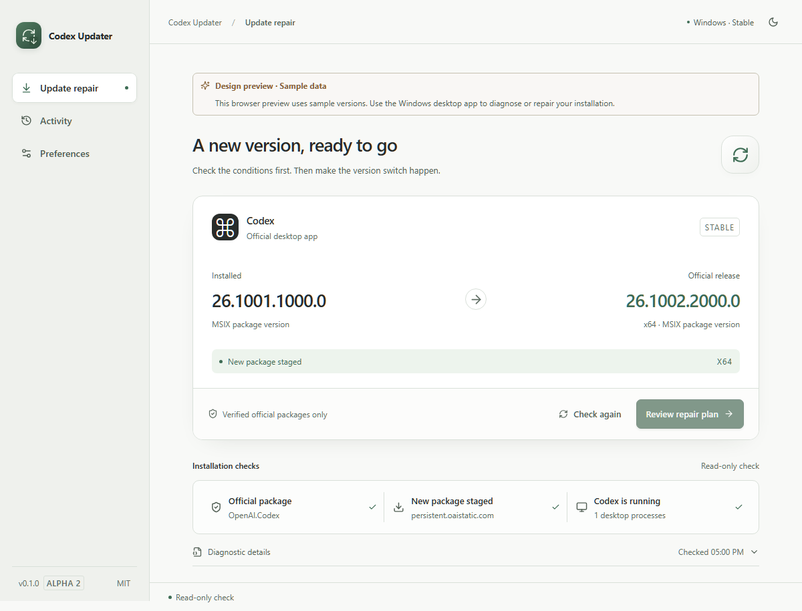

<div align="center">


<h1>Codex Updater</h1>

<p>Repair failed Codex desktop updates.</p>

**English** · [简体中文](README.zh-CN.md)

[](https://github.com/paiwoo/Codex-Updater/actions/workflows/ci.yml)
[](https://github.com/paiwoo/Codex-Updater/releases)
[](#supported-systems)

**[Download installer](https://github.com/paiwoo/Codex-Updater/releases/download/v0.1.0-alpha.2/Codex-Updater_0.1.0-alpha.2_windows-x64_setup.exe)** · **[Download portable ZIP](https://github.com/paiwoo/Codex-Updater/releases/download/v0.1.0-alpha.2/Codex-Updater_0.1.0-alpha.2_windows-x64_portable.zip)**

[Release notes](https://github.com/paiwoo/Codex-Updater/releases/tag/v0.1.0-alpha.2) · [Report a bug](https://github.com/paiwoo/Codex-Updater/issues/new/choose) · [Contributing](CONTRIBUTING.md)

</div>

A Windows tool for fixing failed Codex desktop updates, including updates that remain pending after a restart or fail because the application is still running. It checks the installation, verifies official packages, and lets you continue the repair inside the app.

Alpha software for Windows x64, not an official OpenAI product. Check the [validation record](docs/validation-alpha.2.md) before using it on an active installation.



<details>
<summary>Dark theme and repair progress</summary>


Repair progress (simulated test data, Simplified Chinese interface):


</details>

Screenshots use sample or simulated test data. Desktop builds inspect the actual installation.

## Download and run

Open [Releases](https://github.com/paiwoo/Codex-Updater/releases) and choose the latest **prerelease**:

| File                         | Purpose                                                             |
| ---------------------------- | ------------------------------------------------------------------- |
| `*_windows-x64_setup.exe`    | Installer. Can download WebView2 if it is missing.                  |
| `*_windows-x64_portable.zip` | Extract and run. Microsoft Edge WebView2 must already be installed. |
| `SHA256SUMS.txt`             | SHA-256 checksums for both downloads.                               |

Extract the entire portable ZIP before opening **Codex Updater.exe**. Runtime users do not need Python, Node.js, or Rust. Codex itself must already be installed.

Alpha binaries are **not code signed**. Windows may show an unknown-publisher or SmartScreen message. This is separate from verifying the official Codex package, which the updater checks before deployment.

To verify a downloaded file in PowerShell, compare its hash with `SHA256SUMS.txt` from the same release:

```powershell
Get-FileHash .\Codex-Updater_0.1.0-alpha.2_windows-x64_portable.zip -Algorithm SHA256
```

## How it works

1. **Check first.** Read the registered package, running version, official feeds, staged packages, and recent relevant Windows deployment failures. Checking does not close Codex.
2. **Review the plan.** Start the repair; local task state is checked before Codex closes.
3. **Verify the input.** Prefer a verified package staged by Windows; otherwise download an explicitly published official MSIX. Check signature, publisher, identity, architecture, and version.
4. **Switch versions.** Confirmed idle Codex processes and their associated engine stop automatically. Active or unknown tasks wait for completion or force-quit confirmation. Deploy, launch, and verify the target version.
5. **Read the results.** Package deployment, running version, and update-prompt observation are reported separately.

The interface follows five stages. It shows measured percentages when available, or the current stage and an activity indicator when Windows provides no percentage.

Cancellation is available before deployment. During Windows deployment, closing the interface leaves the independent worker running; reopen the app to reconnect. Keep the computer powered on and the Windows user logged in.

The repair does not uninstall or reset Codex, change sign-in or model configuration, or require Codex++.

## Continue after a failure

Recovery buttons perform actions inside the app. A continuation rechecks installation and task state and preserves the previous record.

| Situation                               | Available action                                                                                                |
| --------------------------------------- | --------------------------------------------------------------------------------------------------------------- |
| Download interrupted or timed out       | Download again and continue. A partial file is never deployed.                                                  |
| Package validation failed               | Download a fresh official package and repeat every check.                                                       |
| Codex still owns the files              | Check tasks and stop idle processes; confirm force quit for active or unknown tasks, or continue after failure. |
| Deployment failed or execution stopped  | Recheck the registered version and continue the steps still needed.                                             |
| Package installed but launch unverified | Continue launch and verification without reinstalling the registered target.                                    |
| Windows denied permission               | Retry deployment. Persistent permission or enterprise-policy restrictions remain blocking errors.               |

If the offered target changes, select **Check again** and review a new plan. The updater does not guess download URLs, downgrade packages, bypass signature checks, or silently elevate permissions.

## Supported systems

| Environment                                         | Status                                                            |
| --------------------------------------------------- | ----------------------------------------------------------------- |
| Windows x64, official stable `OpenAI.Codex` package | Current alpha target; tested on Windows 10 Pro 22H2 with WebView2 |
| Other Windows versions / enterprise-managed devices | Not fully validated; permissions and policy may block repair      |
| Windows ARM64                                       | Not supported by this alpha's repair workflow                     |
| macOS / Linux                                       | Not supported by this alpha's repair workflow                     |
| English / 简体中文                                  | Switch the interface language in Preferences                      |

Tauri's platform support does not make Windows package-repair logic portable. See the [validation records](docs/validation.md) for remaining clean-install and recovery checks.

## Common questions

**No update in Codex, but an old failure in the tool?** A previous repair may fail before another update mechanism completes the installation. A newer diagnostic confirming the target is installed and running moves that old result out of the home page; the original failure stays in **Activity**. No repeated deployment is needed when the installed package meets the release source.

**Different version from Codex's About screen?** The MSIX package version and application display version are different identifiers. This tool compares package versions. An unavailable feed is shown as unknown, not “up to date.”

**Does installation guarantee the prompt disappears?** No. Prompt observation is separate; an inaccessible UI stays **unverified**. The app does not hide a prompt to claim success.

**How lightweight is it?** The app uses system WebView2 rather than bundling Chromium. Runtime memory is higher than package size and varies with WebView2. Background memory hints, renderer suspension where supported, and paused hidden-window polling reduce background activity. Measurements and their limits are in the [validation record](docs/validation.md).

## Diagnostics and privacy

Local state is stored in `%LOCALAPPDATA%\CodexUpdater`. There is no telemetry or automatic diagnostic upload. Update checks and downloads contact the official release source. Shutdown checks read local live-session locks and task lifecycle markers; chat text is not saved or exported. Unknown internal formats require confirmation. CPU usage is not used to infer idle tasks.

Export is an explicit action with a redacted preview; the saved file matches that preview. A fixed field allowlist excludes credentials, chats, model configuration, personal paths, and raw process or event logs.

Review exports before attaching them to an issue. Do not upload the entire runtime folder. Historical scripts in `legacy/powershell/` have different behavior and may create credential backups; they are not the desktop app's entry point or release package.

## Development

See the [build and test guide](docs/development.md) and [contribution guide](CONTRIBUTING.md).

## Release stages and contributing

Versions follow [Semantic Versioning](https://semver.org/): `0.1.0-alpha.2` → `0.1.0-beta.1` → `0.1.0-rc.1` → `0.1.0` (stable). `0.1.0-alpha.1` is the first public test release. Beta requires broader feature and environment validation; release candidates precede a stable release. A `1.0.0` release will require validated installation and recovery flows. See [CHANGELOG.md](CHANGELOG.md).

Read [CONTRIBUTING.md](CONTRIBUTING.md). Reproducible bugs, actionable requests, and public collaboration tasks use [GitHub Issues](https://github.com/paiwoo/Codex-Updater/issues). Local work notes stay in ignored `.scratch/` files. Security-sensitive reports use the private route in [SECURITY.md](SECURITY.md).

## License and attribution

[MIT](LICENSE) · Copyright © 2026 paiwoo.

[Third-party notices](THIRD_PARTY_NOTICES.md) accompany the source and releases. Official Codex packages are downloaded from OpenAI's source and are not redistributed with this tool. Codex and OpenAI names identify the supported product; this project is not affiliated with, endorsed by, or maintained by OpenAI.
