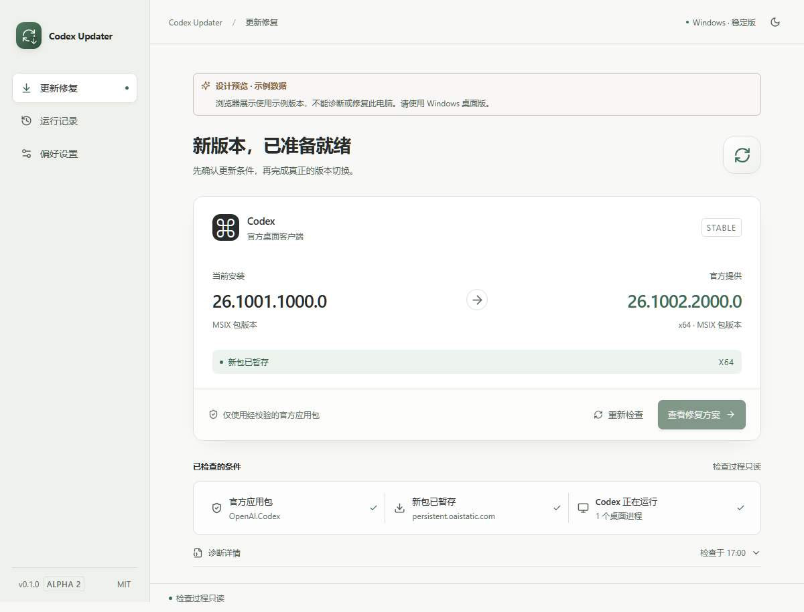
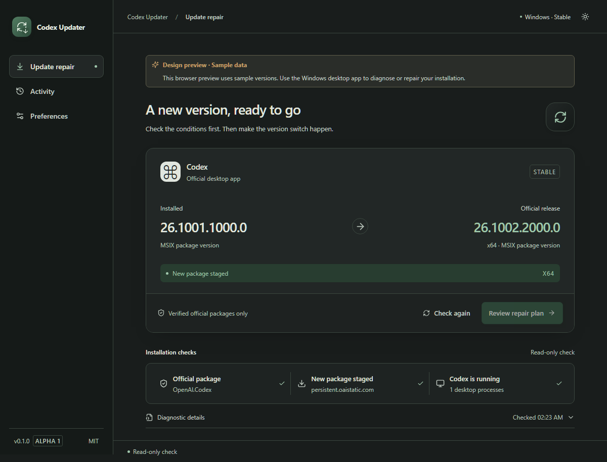
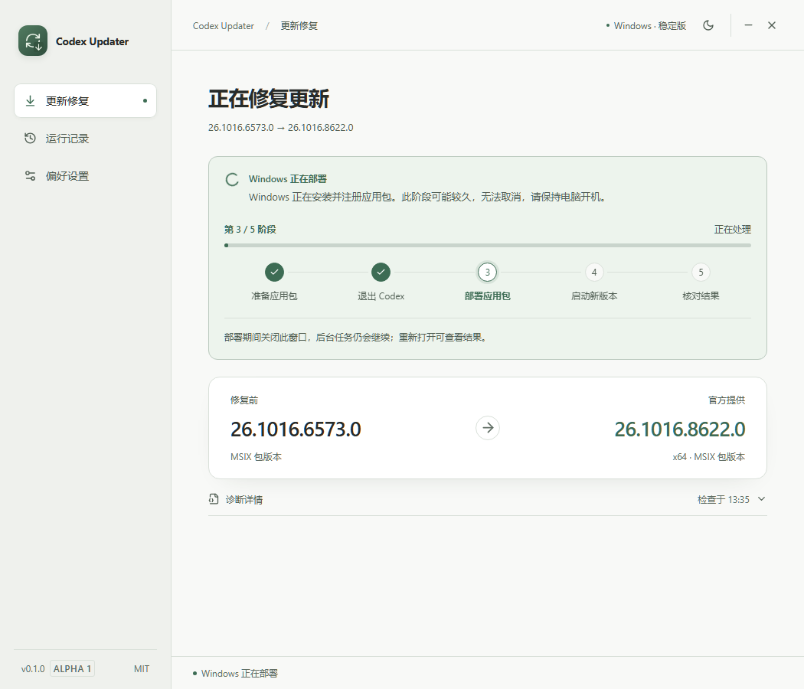

<div align="center">


<h1>Codex Updater</h1>

<p>修复 Codex 桌面端更新失败。</p>

[English](README.md) · **简体中文**

[](https://github.com/paiwoo/Codex-Updater/actions/workflows/ci.yml)
[](https://github.com/paiwoo/Codex-Updater/releases)
[](#支持范围)

**[下载安装版](https://github.com/paiwoo/Codex-Updater/releases/download/v0.1.0-alpha.4/Codex-Updater_0.1.0-alpha.4_windows-x64_setup.exe)** · **[下载便携 ZIP](https://github.com/paiwoo/Codex-Updater/releases/download/v0.1.0-alpha.4/Codex-Updater_0.1.0-alpha.4_windows-x64_portable.zip)**

[发布说明](https://github.com/paiwoo/Codex-Updater/releases/tag/v0.1.0-alpha.4) · [反馈问题](https://github.com/paiwoo/Codex-Updater/issues/new/choose) · [参与贡献](CONTRIBUTING.md)

</div>

用于解决 Codex 桌面端更新失败的 Windows 工具，包括点击更新并重启后仍未更新、应用占用导致安装失败等情况。先检查本机状态、校验官方应用包，再通过软件内的操作继续修复。

当前为 Windows x64 Alpha 测试版，非 OpenAI 官方产品。已完成的检查和待验证项目见[验证记录](docs/validation-alpha.4.md)。



<details>
<summary>查看深色界面与更新进度</summary>





</details>

截图使用示例或模拟测试数据，桌面程序会读取本机的真实安装信息。

## 下载与运行

打开 [Releases](https://github.com/paiwoo/Codex-Updater/releases)，选择最新的 **Prerelease（预发布版）**：

| 文件                         | 用途                                             |
| ---------------------------- | ------------------------------------------------ |
| `*_windows-x64_setup.exe`    | 安装版。缺少 WebView2 时，安装程序可下载运行时。 |
| `*_windows-x64_portable.zip` | 便携版。需已安装 Microsoft Edge WebView2。       |
| `SHA256SUMS.txt`             | 两个下载文件的 SHA-256 校验值。                  |

便携版请完整解压后打开 **Codex Updater.exe**。运行时不需要 Python、Node.js 或 Rust，但需事先安装官方 Codex 桌面客户端。

Alpha 程序**尚未代码签名**，Windows 可能显示未知发布者或 SmartScreen 提示。工具在部署前仍会校验官方 Codex 应用包的签名，两者分别处理。

可用 PowerShell 计算下载文件的校验值，与同一 Release 中的 `SHA256SUMS.txt` 对照：

```powershell
Get-FileHash .\Codex-Updater_0.1.0-alpha.4_windows-x64_portable.zip -Algorithm SHA256
```

## 使用流程

1. **先检查。** 读取注册包、实际运行版本、官方清单、已暂存包和近期相关部署错误。检查不会关闭 Codex。
2. **查看修复方案。** 确认开始后，工具会在退出前检查 Codex 的本地任务状态。
3. **校验应用包。** 优先验证并使用 Windows 已暂存的包，否则下载官方明确发布的 MSIX，核对签名、发布者、身份、架构和目标版本。
4. **切换版本。** 确认空闲时自动结束 Codex 和关联后台引擎，再部署、启动并验证目标版本；有任务或状态未知时，等待结束或由你确认强制退出。
5. **查看分项结果。** 应用包部署、实际运行版本和更新提示分别报告。

等待界面显示五个实际阶段。有真实数据时显示下载或部署百分比；Windows 未提供百分比时，显示当前阶段和执行指示。

部署开始前可以取消。Windows 正在部署时，关闭工具窗口不会结束独立后台任务，重新打开可查看状态。此时请保持电脑开机、当前 Windows 用户已登录。

修复不会卸载或重置 Codex，不修改登录认证与模型配置，也不依赖 Codex++。

## 失败后可以继续做什么

结果页提供可执行的恢复按钮。继续前会核对实际安装和任务状态，并保留原记录。

| 遇到的情况             | 软件内操作                                                               |
| ---------------------- | ------------------------------------------------------------------------ |
| 下载中断、超时         | 重新下载并继续，不使用残缺文件部署。                                     |
| 签名或包校验失败       | 重新下载官方包并执行全部校验。                                           |
| Codex 仍占用文件       | 自动检查空闲任务并退出；有任务或状态未知时可确认强制退出，失败后可继续。 |
| 部署失败、执行中断     | 核对实际注册版本，继续仍需要的步骤。                                     |
| 包已部署，但启动未验证 | 继续启动和验证，不重复安装已注册的目标包。                               |
| Windows 拒绝权限       | 重试部署；持续的权限或企业策略限制仍会阻断。                             |

若官方目标版本已经变化，请点击“重新检查”并查看新方案。工具不会猜测下载地址、降级安装、跳过签名校验或静默提权。

## 支持范围

| 环境                                          | 当前状态                                                              |
| --------------------------------------------- | --------------------------------------------------------------------- |
| Windows x64，官方稳定版 `OpenAI.Codex` 应用包 | 当前 Alpha 目标；已在 Windows 10 Pro 22H2、已安装 WebView2 的环境验证 |
| 其他 Windows 版本、企业管理设备               | 尚未完整验证，权限或策略可能阻止修复                                  |
| Windows ARM64                                 | 本 Alpha 版的修复流程暂不支持                                         |
| macOS / Linux                                 | 本 Alpha 版的修复流程暂不支持                                         |
| 简体中文 / English                            | 可在“偏好设置”中切换界面语言                                          |

Tauri 的跨平台能力不代表 Windows 应用包修复流程已经跨平台。干净机器安装等验证范围见[验证记录](docs/validation.md)。

## 常见问题

**客户端没有更新提示，为什么工具里还有旧失败？** 某次修复可能先失败，随后由其他更新机制完成安装。较新的检查确认目标版本已安装并实际运行后，旧结果只保留在“运行记录”，不会继续占据首页。当前安装包达到发布源版本时，无需再次部署。

**为什么版本号和 Codex“关于”里的不一样？** Windows MSIX 包版本与客户端显示版本采用不同编号。工具比较包版本；无法读取官方源时显示“还不能判断”，不会把网络失败当成“已经最新”。

**安装成功后，更新提示一定会消失吗？** 不保证。提示观察与部署结果分别报告。无法可靠读取界面时保留“未验证”，不通过隐藏提示伪造成功。

**轻量化体现在哪里？** 程序复用系统 WebView2，不捆绑 Chromium。运行内存高于安装包大小，并随运行时变化；已加入后台低内存提示、支持时挂起渲染器、隐藏时暂停轮询等措施。实测数据与局限见[验证记录](docs/validation.md)，不以安装包大小代替内存指标。

## 诊断与隐私

运行状态保存在 `%LOCALAPPDATA%\CodexUpdater`。不收集遥测，不自动上传日志；更新检查和下载会访问官方发布源。退出前只在本机读取活动会话的锁与任务生命周期标记，不保存或导出聊天文本。内部格式不识别时会要求确认，不按 CPU 占用猜测空闲。

用户主动导出时先显示脱敏预览，保存文件与预览一致。导出采用固定字段白名单，不包含认证、聊天内容、模型配置、个人路径、原始进程列表或完整系统事件日志。

提交问题前请检查导出内容，不要上传整个运行目录。`legacy/powershell/` 中保留的是历史脚本，行为不同，可能创建认证备份；它们不是桌面程序入口，也不随新程序安装包发布。

## 开发

见[构建与测试说明](docs/development.md)和[贡献指南](CONTRIBUTING.md)。

## 版本阶段与参与贡献

使用[语义化版本](https://semver.org/lang/zh-CN/)，按 `0.1.0-alpha.4` → `0.1.0-beta.1` → `0.1.0-rc.1` → `0.1.0`（正式版）推进。`0.1.0-alpha.1` 为首次公开测试版；功能和环境验证扩大后进入 beta，正式发布前使用 rc。到 `1.0.0` 前需要完成安装和失败恢复流程验证，详见 [CHANGELOG.md](CHANGELOG.md)。

请阅读 [CONTRIBUTING.md](CONTRIBUTING.md)。可复现的缺陷、明确需求和公开协作任务使用 [GitHub Issues](https://github.com/paiwoo/Codex-Updater/issues)；日常试验与工作草稿保留在被忽略的 `.scratch/` 中。安全敏感问题按 [SECURITY.md](SECURITY.md) 使用私密报告入口。

## 许可与署名

[MIT](LICENSE) · Copyright © 2026 paiwoo。

源码与发布包包含[第三方许可声明](THIRD_PARTY_NOTICES.md)。Codex 应用包由工具从官方来源下载，不随本项目分发。Codex 和 OpenAI 名称仅标识支持的产品；本项目与 OpenAI 无隶属关系，也不由 OpenAI 背书或维护。
